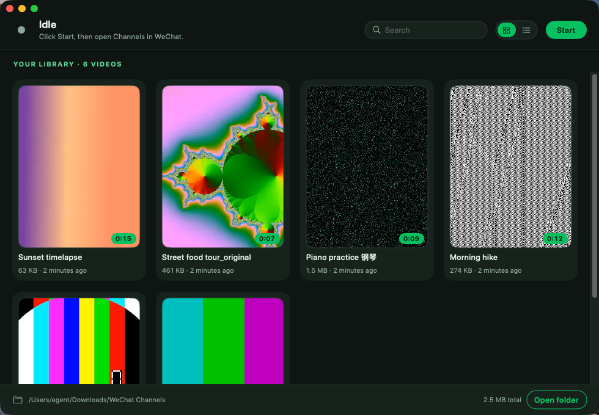
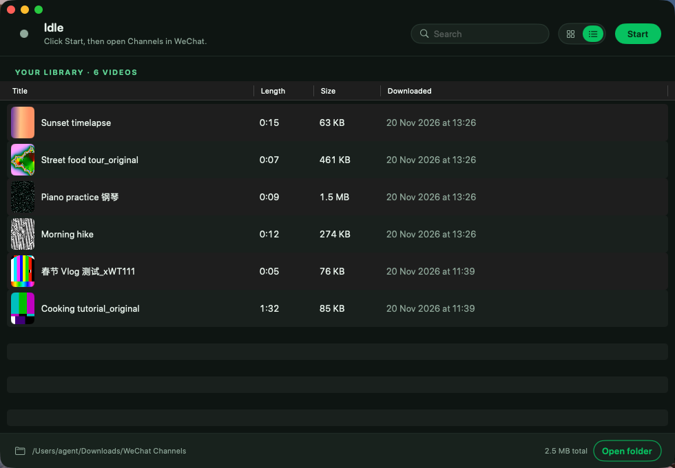
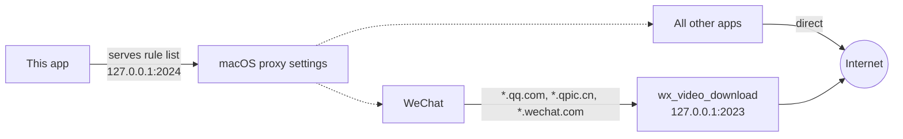

# WeChat Channels Downloader for Mac

A native macOS app for saving WeChat Channels (视频号) videos as MP4 files, without using the Terminal.
It starts and stops the open-source [wx_channels_download](https://github.com/ltaoo/wx_channels_download)
downloader for you, shows everything you've saved in a searchable library, and works while a VPN is on.



<sub>Screenshot taken in a test VM with generated sample clips.</sub>

## Features

- **One-click Start / Stop.** No Terminal window, no Ctrl+C. Quitting the app always stops the downloader.
- **Video library.** Thumbnails, length, size and date in a grid or list. Search by title. New downloads
  appear by themselves.
- **Play, rename, reveal, trash.** Double-click plays in QuickTime Player. Right-click for Show in Finder,
  Rename and Move to Trash (nothing is ever deleted outright).
- **Drag out.** Drag a video to Finder, the Desktop or a chat app. It is always copied, never moved.
- **Only WeChat goes through the downloader.** The app sets a proxy *rule list* (PAC) that sends just
  WeChat's addresses to the downloader. Your browser, Claude, Slack and every other app connect directly,
  so stopping the downloader never cuts them off.
- **VPN mode.** Works while a VPN is your Mac's main connection. You set it up once with your password;
  after that Start needs no password.
- **Fails safe.** If the app quits, crashes or is force-quit, nothing serves the rule list any more and
  macOS connects everything directly. A leftover setting can't break your internet.

<details>
<summary>List view</summary>



</details>

## How it works



1. **Start.** The app checks that the downloader's certificate is trusted (macOS asks for your password
   the first time), then runs the downloader with its own copy of the config (`app-config.yaml`), in which
   the downloader's "set the system proxy" switch is off.
2. Once the downloader is listening, the app points your network services at its rule list. WeChat's
   addresses go through the downloader; everything else goes direct.
3. The downloader adds a download button to Channels videos in WeChat. Videos land in
   `~/Downloads/WeChat Channels`, and the library picks them up.
4. **Stop / Quit.** The app switches the rule list off and stops the downloader. While the downloader is
   down, the rule list says "everything direct" anyway.

**VPN mode.** While a VPN is the main connection, macOS takes proxy settings from the VPN's connection, not
from Wi-Fi. A small root helper (installed once) adds the rule list to the VPN connection while the
downloader runs, and removes it when the downloader stops. It only does so when the downloader *and* the
rule-list server belong to the logged-in user's own programs.

## Requirements

- macOS 14 or later (developed on macOS 27, Apple silicon).
- Apple's Command Line Tools (`xcode-select --install`) or Xcode, for Swift 6.
- WeChat for Mac (tested with 4.1.15).
- [wx_channels_download](https://github.com/ltaoo/wx_channels_download/releases) for macOS
  (tested with v261106). It is **not** included here; see Licence.

## Setup

### 1. Install the downloader

The app expects the downloader in `~/Applications/WeChat Channels Downloader/`.

1. Download `wx_video_download_<version>_darwin_arm64.zip` (or `_x86_64` for Intel) from the
   [releases page](https://github.com/ltaoo/wx_channels_download/releases).
2. Unzip it and put `wx_video_download` and `config.yaml` in `~/Applications/WeChat Channels Downloader/`.

### 2. Give it a certificate of your own

The downloader reads HTTPS traffic from WeChat, so it needs a certificate that your Mac trusts. Its
built-in certificate is the same for every user, so make your own instead:

```bash
cd ~/Applications/"WeChat Channels Downloader"
mkdir -p certs
openssl req -x509 -newkey rsa:2048 -nodes -days 3650 \
  -subj "/CN=WeChat Channels Downloader CA ($(scutil --get LocalHostName))" \
  -addext "basicConstraints=critical,CA:TRUE,pathlen:0" \
  -addext "keyUsage=critical,keyCertSign,cRLSign,digitalSignature" \
  -keyout certs/ca.key -out certs/ca.pem
chmod 600 certs/ca.key
```

Then edit `config.yaml`:

```yaml
download:
  dir: "%UserDownloads%/WeChat Channels"   # where videos are saved

proxy:
  skipInstallRootCert: true                 # never install the shared built-in certificate

# at the end of the file (use your own home folder path):
cert:
  file: "/Users/<you>/Applications/WeChat Channels Downloader/certs/ca.pem"
  key: "/Users/<you>/Applications/WeChat Channels Downloader/certs/ca.key"
  name: "WeChat Channels Downloader CA"
```

You don't need to change `proxy.system`: the app runs the downloader with its own copy of this file in
which that switch is off.

### 3. Build and install the app

```bash
git clone https://github.com/guankaiyang/wechat-channels-downloader.git
cd wechat-channels-downloader/app
scripts/build-app.sh --install
```

This builds `WeChat Channels Downloader.app`, signs it for this Mac only (ad-hoc), and copies it to
`~/Applications`. Open it from there and keep it in the Dock.

### 4. First run

1. Click **Start**. The first time, macOS asks for your password to trust your certificate.
2. Open **Channels** in WeChat, play a video and click its download button.
3. If a VPN is on, the app shows **Set up VPN mode**. Click it once and enter your password.

## Using a VPN

VPN mode works with any VPN that becomes your Mac's main connection (its network interface is `utun`,
`ppp` or `ipsec`). You don't need it if your VPN app can leave WeChat out of the tunnel (split tunnelling).

- VPN mode needs the app open: the rule list is served by the app.
- If your VPN sets its own proxy on its connection, the helper leaves it alone and the app tells you that
  WeChat isn't going through the downloader.
- After updating the app, you may see **Update helper**. That needs your password once.

## What it changes on your Mac

| What | When | How to undo |
|---|---|---|
| Your certificate in the login keychain | First Start | Keychain Access › delete "WeChat Channels Downloader CA" |
| Proxy rule list (`http://127.0.0.1:2024/proxy.pac`) on your network services | While capturing | Switched off on Stop; harmless if left on |
| Root helper (`/Library/PrivilegedHelperTools/`, `/Library/LaunchDaemons/`) | Only if you set up VPN mode | App menu › **Remove VPN Helper…** |
| `app-config.yaml` next to `config.yaml` | Every Start | Delete it; it is recreated |

To uninstall: remove the VPN helper (app menu), quit the app, delete the app and the
`~/Applications/WeChat Channels Downloader` folder, and delete the certificate in Keychain Access.

## Troubleshooting

- **No download button in WeChat.** Check that the app says *Capturing*. If a VPN is on, the strip under
  the top bar must say *VPN mode on*. Quit and reopen WeChat after starting.
- **Web pages won't load after a crash.** Reopen the app: it cleans up at launch. If the strip says your
  VPN still points at the downloader, click **Fix**.
- **"Couldn't serve the proxy rule list".** Something else is using port 2024 on your Mac.
- **Downloads in progress.** Click **Progress** to open the downloader's own page.

## Development

```bash
cd app
scripts/test.sh            # unit and integration tests (swift-testing)
scripts/build-app.sh       # build without installing
```

`scripts/test.sh` passes the swift-testing plugin path explicitly, which Command Line Tools need. To also
run the real downloader in a test, set `QA_SUPPORT_DIR` to a folder with a copy of the downloader whose
`config.yaml` uses ports 2032/2033 and `proxy.system: false`.

| Folder | Contents |
|---|---|
| `app/Sources/DownloaderCore` | Starting/stopping the downloader, proxy rule list and its server, VPN helper scripts, library scanning |
| `app/Sources/AppViews` | Theme, buttons, thumbnails, drag-out |
| `app/Sources/ChannelsDownloader` | The SwiftUI app: status bar, library, menus |
| `app/Tests` | Tests, including fakes for `networksetup`, `scutil`, `lsof` and `nc` so nothing touches your Mac |
| `docs/` | Design notes, implementation plans and a progress log of every decision and check |

## Licence

The code in this repository is released under the [MIT Licence](LICENSE).

The downloader it controls, [wx_channels_download](https://github.com/ltaoo/wx_channels_download) by
ltaoo, is a separate project under its own licence (MIT with the Commons Clause). It is not included in
this repository; download it from its releases page.

Use this to save videos for your own use, and respect the creators' rights and WeChat's terms.
